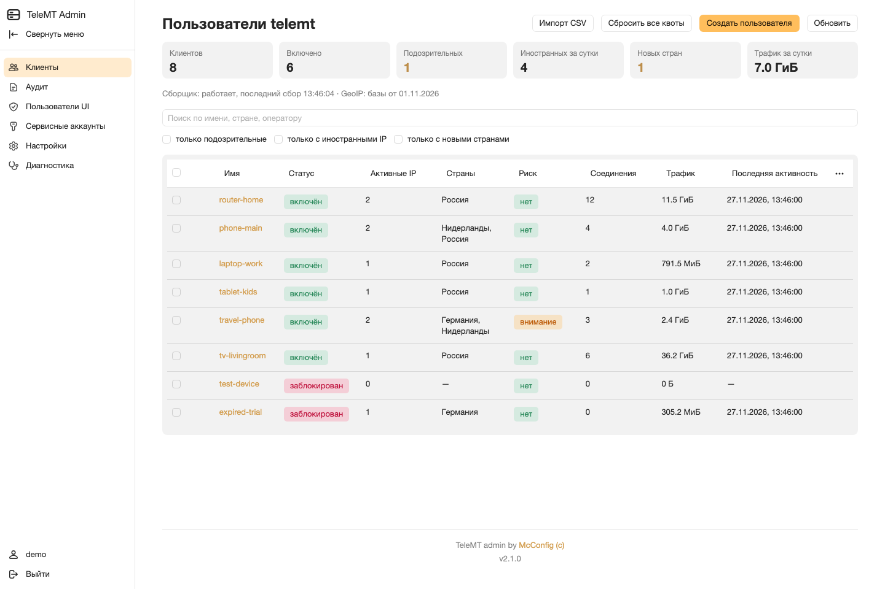
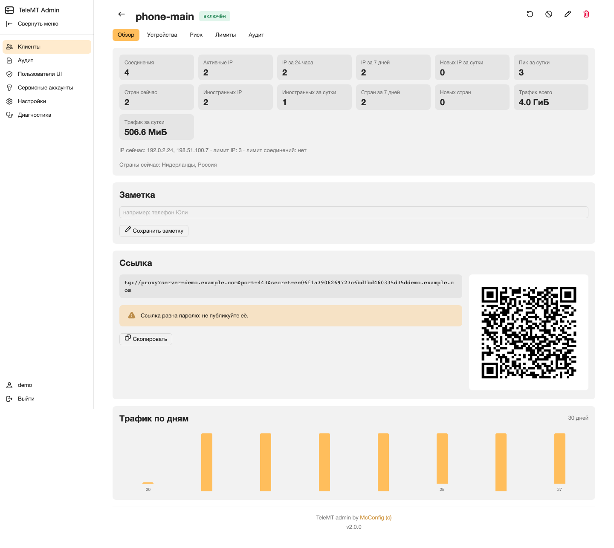

# TeleMT Admin

[Русская версия](README.md)

Web interface for managing [telemt](https://github.com/telemt/telemt)
MTProto proxy users. It talks to the official Control API and never stores
proxy secrets.

## Demo

A self-contained demo runs the real `tgadmin` against a fake telemt Control
API. No proxy, domain or real secret is needed: eight clients, eight days of
history, countries, audit and limits are generated locally.

```bash
cd deploy/demo
cp .env.example .env
docker compose up -d --build
docker compose --profile seed run --rm seed
```

Open <http://localhost:8090> and sign in as `demo` with password
`demo-admin-password`. See [deploy/demo/README.md](deploy/demo/README.md) for
details, screenshots and cleanup.

| Clients | Client card |
|---|---|
|  |  |

## Features

- list proxy clients with connections, active IPs and traffic;
- create, rename, rotate, disable and delete clients without breaking
  existing keys;
- per-client limits: traffic quota, rate, expiration and source deny;
- IP and country history with GeoIP, new-country detection and alerts;
- trusted countries and addresses to suppress false positives;
- per-client risk thresholds for active and weekly addresses, with an option
  to ignore new countries and inherit global defaults;
- risk report with reasons and thresholds, daily address lists with first and
  last seen time, trust actions and CSV export;
- TOTP two-factor authentication with recovery codes;
- audit log, CSV export, Prometheus metrics and Grafana dashboards;
- local-only access control, Argon2id passwords and CSRF protection.

## Quick start

See [README.md](README.md) for installation, environment variables,
reverse-proxy configuration and deployment. A short version:

```bash
cd deploy
cp .env.example .env
docker compose up -d
docker compose run --rm tgadmin user add admin --role admin
```

The interface is served on port 8090. Put it behind HTTPS and allow only
your networks.

## Documentation

- [API reference](docs/API.md)
- [Upgrade and compatibility](docs/UPGRADE.md)
- [Architecture](docs/ARCHITECTURE.md)
- [Roadmap](docs/ROADMAP.md)
- [Coding standards](docs/CODING_STANDARDS.md)
- [Dependencies](docs/DEPENDENCIES.md)
- [Architecture decisions](docs/adr/README.md)
- [Achievements](docs/ACHIEVEMENTS.md)
- [Security assurance case](docs/ASSURANCE.md)
- [Demo stack](deploy/demo/README.md)
- [Changelog](CHANGELOG.md)

## Security

Report vulnerabilities privately via
[GitHub Security Advisories](https://github.com/McConfig/telemt-admin/security/advisories/new).
See [SECURITY.md](SECURITY.md) for supported versions and response times.

## Contributing

See [CONTRIBUTING.md](CONTRIBUTING.md) and
[CODE_OF_CONDUCT.md](CODE_OF_CONDUCT.md). Issues and review comments are
accepted in English.

## License

MIT. See [LICENSE](LICENSE).
