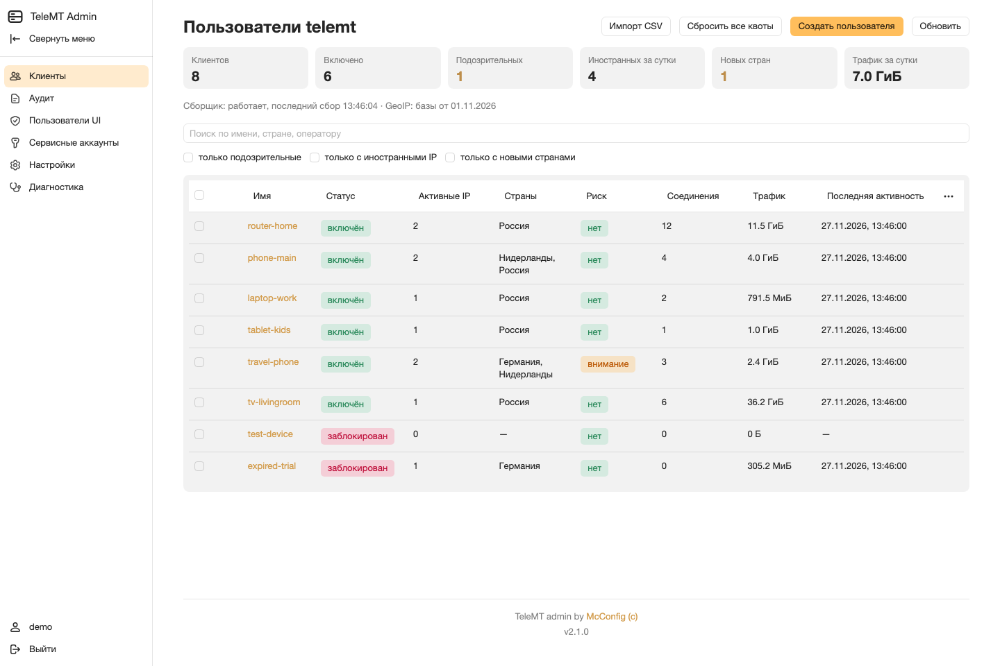
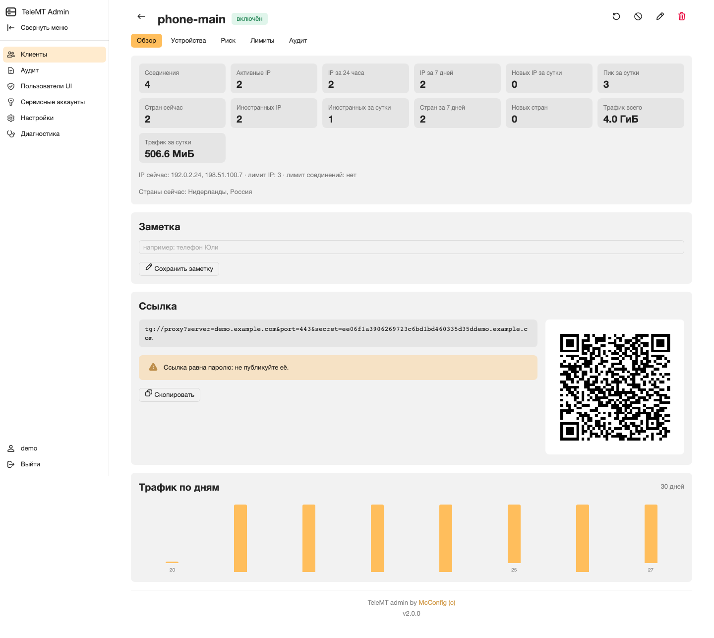

# TeleMT Admin

[](https://github.com/McConfig/telemt-admin/actions/workflows/ci.yml)
[](https://github.com/McConfig/telemt-admin/actions/workflows/codeql.yml)
[](https://github.com/McConfig/telemt-admin/releases)
[](https://github.com/McConfig/telemt-admin/actions/workflows/ci.yml)
[](https://github.com/McConfig/telemt-admin/actions/workflows/ci.yml)
[](.golangci.yml)
[](https://securityscorecards.dev/viewer/?uri=github.com/McConfig/telemt-admin)
[](https://www.bestpractices.dev/projects/17095)
[](LICENSE)
[](go.mod)

[История изменений](CHANGELOG.md) · [Политика безопасности](SECURITY.md) · [API](docs/API.md)

[English summary](README.en.md) · [Участие](CONTRIBUTING.md) · [Кодекс поведения](CODE_OF_CONDUCT.md) · [Управление](GOVERNANCE.md)

Веб-интерфейс для управления пользователями [telemt](https://github.com/telemt/telemt) —
MTProto-прокси для Telegram. Работает через официальный
[Control API](https://github.com/telemt/telemt/blob/main/docs/Architecture/API/API.md)
и не хранит секреты прокси.

## Демо

Демо-стенд поднимает настоящий `tgadmin` с фейковым Control API: реальный
прокси, домены и секреты не нужны. Внутри 8 клиентов, история за 8 дней,
страны, аудит и лимиты.

```bash
cd deploy/demo
cp .env.example .env
docker compose up -d --build
docker compose --profile seed run --rm seed
```

Откройте <http://localhost:8090>, войдите как `demo` с паролем
`demo-admin-password`. Подробности, смена версии, скриншоты и удаление
данных — в [deploy/demo/README.md](deploy/demo/README.md).

| Клиенты | Карточка клиента |
|---|---|
|  |  |

## Возможности

- список пользователей: статус, активные IP, соединения, суммарный трафик,
  поиск по имени, стране и оператору, сортировка по трафику, IP, риску и
  активности;
- создание пользователя с необязательным секретом и лимитами;
- импорт клиентов из CSV с проверкой без записи, шаблоном, предпросмотром
  по строкам и отчётом «создано / пропущено / ошибка»; существующие
  клиенты не изменяются;
- карточка: ссылка `tg://proxy` и QR-код, только для роли `admin`;
- перевыпуск секрета с подтверждением;
- блокировка и разблокировка (активные сессии закрываются);
- переименование с сохранением ключа: ссылки на устройствах продолжают работать;
- удаление с подтверждением; последнего пользователя удалить нельзя;
- лимиты: максимум уникальных IP и максимум TCP-соединений;
- роли `admin` и `viewer`; `viewer` не видит ссылки и ничего не меняет;
- пароли Argon2id, сессии в Valkey, CSRF, ограничение попыток входа, аудит действий;
- двухфакторная аутентификация TOTP с резервными кодами;
- сводка на странице клиентов: всего, подозрительные, иностранные адреса,
  новые страны, трафик и состояние сборщика с базами GeoIP;
- карточка клиента разбита на вкладки «Обзор», «Устройства», «Лимиты»;
- таймлайн активности: новые адреса и страны по дням, пик устройств, трафик;
- доверенные страны и адреса: остаются в истории, но не поднимают риск;
- пороги риска на клиента: свои лимиты IP и адресов за 7 дней, отключаемая
  реакция на новую страну, пустые поля наследуют глобальные значения;
- диагностика: Control API, сборщик, GeoIP, Valkey, вебхуки, бэкапы и
  2FA; единые коды ошибок Control API с подсказками;
- отчёт по риску: причины с фактическими значениями и порогами, дни,
  адреса с временем первого и последнего появления за день, доверие IP и
  стране, экспорт CSV;
- страница «Настройки» на вкладках: глобальные пороги риска и домашняя
  страна, TTL сессий, режим ссылок, интервал сбора и retention, лимиты
  входов, TOTP, аудит, пароль, период графиков, уровень логов, обязательная
  2FA с льготным сроком, вебхуки событий, расписание бэкапов, шаблоны
  лимитов, расписание автосброса квот, статус бэкапов, системная панель
  и история изменений; будущие
  настройки видны с версией и неактивны;
- аудит с поиском, фильтром по действию и датам, страницами и вкладкой в
  карточке клиента;
- массовые действия в списке: отключить, включить, выгрузить ссылки,
  сбросить квоты выбранным или всем клиентам с отчётом
  «сброшено / отказано / неизвестно / не отправлено»;
- автосброс квот: глобальный интервал и время, режимы «как у всех»,
  «не сбрасывать» и своё расписание на клиента, точка отсчёта после
  ручного сброса, защита от одновременного сброса и аудит; сбрасывается
  только расход квоты, лимиты, ссылки, история и трафик сохраняются;
- сервисные аккаунты и API-токены: права `read / write / admin`, срок
  жизни или бессрочный токен, отзыв, отключение сервиса, аудит и показ
  токена только один раз; запросы по `Authorization: Bearer`;
  управление администраторами UI по токену запрещено;
- доступ только с разрешённых сетей;
- GeoIP: страна и оператор (ASN) каждого адреса, история стран за сутки и
  неделю, метка «новая страна», фильтры «только с иностранными IP» и
  «только с новыми странами».

## API-токены

Для скриптов создайте сервисный аккаунт в «Сервисные аккаунты», выпустите
токен и передавайте его в заголовке:

```bash
curl -H "Authorization: Bearer tgadm_..." https://tgadmin.example.com/api/users
```

Полный токен показывается один раз. Права `read`, `write` и `admin`
описаны в [API](docs/API.md). Доступ по-прежнему ограничен
`TGADMIN_ALLOWED_CIDRS`.

## Документация проекта

- [Архитектура](docs/ARCHITECTURE.md) — компоненты, границы доверия, поток данных.
- [API](docs/API.md) — эндпоинты, роли, ошибки.
- [Обновление](docs/UPGRADE.md) — совместимость и откат.
- [Стандарты кода](docs/CODING_STANDARDS.md).
- [Зависимости](docs/DEPENDENCIES.md).
- [Планы](docs/ROADMAP.md).
- [Достижения](docs/ACHIEVEMENTS.md).
- [Assurance case](docs/ASSURANCE.md).
- [Диагностика и ошибки API](docs/DIAGNOSTICS.md).
- [Участие](CONTRIBUTING.md) и [кодекс поведения](CODE_OF_CONDUCT.md).
- [Управление проектом](GOVERNANCE.md).
- [Решения по архитектуре](docs/adr/README.md) — ADR.
- [Демо-стенд](deploy/demo/README.md) — фейковый telemt и скриншоты.

## Архитектура

```
браузер
  │ HTTPS (TLS на reverse-proxy)
  ▼
tgadmin :8090
  ├─ проверка CIDR источника
  ├─ сессия в cookie → Valkey
  ├─ шаблоны, CSRF, QR
  └─ клиент Control API → telemt :9091

Valkey ── пользователи UI, сессии, счётчики входов, аудит
telemt :8444 ── MTProto-прокси для Telegram
```

TLS завершается внешним reverse-proxy. Приложение получает обычный HTTP и
проверяет адрес источника по `TGADMIN_ALLOWED_CIDRS`.

## Требования

- Docker и Docker Compose;
- для разработки без Docker: Go 1.26 и Node.js 24;
- открытый порт прокси (по умолчанию 8444), если нужен доступ снаружи;
- свой домен и TLS для публикации интерфейса.

`deploy/docker-compose.yml` поднимает все три сервиса: `telemt`, `tgadmin`,
`valkey`. Если `telemt` у вас уже есть, уберите сервис `telemt` из compose и
укажите его адрес в `TELEMT_API_URL`.
- reverse-proxy с TLS для публикации (nginx, Caddy, Traefik или встроенный
  reverse-proxy роутера);
- сеть, из которой разрешён доступ.

## Готовый образ

Образы для `linux/amd64` и `linux/arm64` публикуются в GHCR:

```bash
docker pull ghcr.io/mcconfig/telemt-admin:v0.4.0
```

Тег `latest` не используется: в примере и в `deploy/docker-compose.yml`
указана конкретная версия. Обновляйтесь осознанно, меняя тег.

## Установка

1. Соберите конфигурацию telemt и секрет:

```bash
DOMAIN=proxy.example.com PORT=8444 bash deploy/telemt-init.sh
```

Скрипт создаёт `deploy/telemt/secret`, собирает `deploy/telemt/config.toml`
и печатает ссылку `tg://proxy`. Повторный запуск секрет не меняет.

2. Скопируйте пример окружения и задайте значения:

```bash
cp deploy/.env.example deploy/.env
```

Обязательно поменяйте `VALKEY_PASSWORD` и `TGADMIN_BASE_URL`.

3. Запустите сервисы:

```bash
cd deploy
docker compose up -d
```

4. Создайте первого администратора. Пароль вводится интерактивно и в
   переменные окружения не попадает:

```bash
docker compose run --rm tgadmin user add admin --role admin
```

5. Проверьте, что приложение отвечает:

```bash
curl -fsS http://127.0.0.1:8090/healthz
```

Ожидаемый ответ: `ok`.

6. Откройте интерфейс по адресу из `TGADMIN_BASE_URL` и войдите.
7. Подключите Telegram по ссылке из карточки пользователя `main` (или создайте
   отдельного пользователя).

## Переменные окружения

| Переменная | По умолчанию | Назначение |
|---|---|---|
| `TGADMIN_LISTEN` | `:8090` | адрес HTTP-сервера |
| `TGADMIN_ALLOWED_CIDRS` | `127.0.0.1/32,10.0.0.0/8,172.16.0.0/12,192.168.0.0/16` | сети, которым разрешён доступ |
| `TGADMIN_TRUSTED_PROXIES` | пусто | адреса reverse-proxy, от которых принимается `X-Forwarded-For` |
| `TGADMIN_COLLECT_INTERVAL` | `60s` | как часто снимать активные IP и трафик через API |
| `TGADMIN_RETENTION` | `720h` | сколько хранить историю IP |
| `TGADMIN_RISK_IPS_WARN` | `3` | одновременных IP, после которых предупреждение |
| `TGADMIN_RISK_IPS_HIGH` | `5` | одновременных IP, после которых высокий риск |
| `TGADMIN_RISK_DISTINCT_7D` | `15` | уникальных IP за 7 дней для предупреждения |
| `TGADMIN_HOME_COUNTRY` | `RU` | домашняя страна: её адреса не считаются иностранными |
| `TGADMIN_BACKUP_STATUS` | пусто | путь к JSON статуса бэкапов хоста для панели «Настройки» |
| `TGADMIN_GEOIP_CITY` | `/opt/geoip/GeoLite2-City.mmdb` | городская база mmdb; пусто — не использовать |
| `TGADMIN_GEOIP_ASN` | `/opt/geoip/GeoLite2-ASN.mmdb` | база ASN mmdb; пусто — не использовать |
| `TGADMIN_BASE_URL` | `https://tgadmin.example.com` | внешний адрес; проверка Origin и ссылки |
| `TGADMIN_SESSION_TTL` | `720h` | срок жизни сессии |
| `TGADMIN_LOGIN_MAX_FAILURES` | `10` | неудачных входов до блокировки |
| `TGADMIN_LOGIN_WINDOW` | `15m` | окно подсчёта неудачных входов |
| `TGADMIN_TOTP_PENDING_TTL` | `5m` | срок ожидания второго фактора |
| `TGADMIN_TOTP_MAX_ATTEMPTS` | `5` | попыток ввода кода TOTP |
| `TGADMIN_AUDIT_MAX_EVENTS` | `10000` | сколько событий аудита хранить |
| `TGADMIN_PASSWORD_MIN_LENGTH` | `12` | минимальная длина пароля |
| `TGADMIN_DEFAULT_CHART_DAYS` | `30` | период графиков по умолчанию |
| `TGADMIN_LOG_LEVEL` | `info` | `debug`, `info`, `warn`, `error` |
| `TGADMIN_REQUIRE_2FA` | `false` | обязательная 2FA для администраторов |
| `TGADMIN_REQUIRE_2FA_GRACE_DAYS` | `7` | льготный срок на включение 2FA |
| `TGADMIN_WEBHOOK_URL` | пусто | URL вебхука событий |
| `TGADMIN_WEBHOOK_SECRET` | пусто | секрет HMAC для вебхука |
| `TGADMIN_WEBHOOK_EVENTS` | список событий | какие события отправлять |
| `TGADMIN_BACKUP_SCHEDULE` | `04:30` | время ежедневного снимка |
| `TGADMIN_BACKUP_KEEP_DAYS` | `14` | сколько дней хранить снимки |
| `TGADMIN_BACKUP_RESTORE_TEST` | `true` | проверять восстановление |
| `TGADMIN_BACKUP_CONFIG` | пусто | путь к JSON расписания для хоста |
| `TGADMIN_QUOTA_RESET_ENABLED` | `false` | автосброс квот при старте; далее настройка в UI |
| `TGADMIN_QUOTA_RESET_DAYS` | `30` | интервал автосброса в днях, от 1 до 365 |
| `TGADMIN_QUOTA_RESET_TIME` | `04:00` | время автосброса `ЧЧ:ММ`, минуты кратны 5 |
| `TGADMIN_TOTP_KEY` | пусто | ключ шифрования секретов 2FA, 32 байта в base64; без него включить 2FA нельзя |
| `TGADMIN_COOKIE_SECURE` | `true` | `Secure` у cookie; выключайте только для локальной проверки по HTTP |
| `VALKEY_URL` | `redis://valkey:6379/0` | подключение к Valkey |
| `VALKEY_PASSWORD` | — | пароль Valkey, задайте свой |
| `TELEMT_API_URL` | `http://127.0.0.1:9091` | Control API telemt |
| `TELEMT_API_TOKEN` | пусто | значение заголовка авторизации, если включён в telemt |
| `TELEMT_LINK_MODE` | `tls` | какие ссылки показывать: `tls`, `secure`, `classic` |

Пороги риска, TTL сессий, режим ссылок, интервал сбора и retention,
расписание вебхуков и бэкапов, а также глобальное расписание автосброса
квот можно переопределить на странице «Настройки». Env остаётся значением
по умолчанию, изменения применяются без перезапуска. Расписание сброса
квоты отдельного клиента задаётся в его карточке на вкладке «Лимиты».

## Настройка telemt

### Control API

В конфигурации telemt включите API и разрешите адрес, с которого ходит
контейнер:

```toml
[server.api]
enabled = true
listen = "192.0.2.10:9091"
whitelist = ["127.0.0.1/32", "172.16.0.0/12"]
```

`172.16.0.0/12` — docker-сети. Адрес и подсеть подставьте свои. Проверка:

```bash
curl -fsS http://192.0.2.10:9091/v1/capabilities | head -c 200
```

### Ссылки

Чтобы в ссылках был ваш домен, а не определённый автоматически адрес:

```toml
[general.links]
public_host = "proxy.example.com"
public_port = 443
```

`public_host` и `public_port` влияют только на формирование ссылок.

### Пользователь для проверки

```bash
curl -fsS -X POST http://192.0.2.10:9091/v1/users \
  -H 'Content-Type: application/json' \
  -d '{"username":"demo","max_unique_ips":2}'
```

## Публикация и ограничение доступа

Пример для nginx:

```nginx
server {
    listen 443 ssl;
    server_name tgadmin.example.com;

    ssl_certificate     /etc/ssl/tgadmin.crt;
    ssl_certificate_key /etc/ssl/tgadmin.key;

    location / {
        proxy_pass http://127.0.0.1:8090;
        proxy_set_header Host $host;
        proxy_set_header X-Forwarded-For $proxy_add_x_forwarded_for;
    }
}
```

TLS можно также завершать на встроенном reverse-proxy роутера; тогда достаточно
проксировать имя на `tgadmin:8090`.

Доступ ограничивается на двух уровнях:

1. приложение отдаёт `403` всем адресам вне `TGADMIN_ALLOWED_CIDRS`;
2. при возможности добавьте правило на внешнем прокси или файрволе, чтобы
   запросы снаружи не доходили до приложения.

Если reverse-proxy подменяет источник своим адресом и передаёт настоящий в
`X-Forwarded-For`, укажите адрес прокси в `TGADMIN_TRUSTED_PROXIES`
(например, `10.0.0.1/32`). Берётся последний адрес цепочки, поэтому клиент не
может подделать источник, дописав свой заголовок.

## Создание пользователей UI

```bash
docker compose run --rm tgadmin user add alice --role viewer
docker compose run --rm tgadmin user passwd alice
docker compose run --rm tgadmin user list
docker compose run --rm tgadmin user disable alice
docker compose run --rm tgadmin user enable alice
docker compose run --rm tgadmin user totp-reset alice
```

`user totp-reset` выключает второй фактор и завершает сессии: аварийный
способ входа, если администратор потерял телефон и резервные коды.

## Обновление

Порядок обновления, отката и совместимость схемы Valkey — в
[docs/UPGRADE.md](docs/UPGRADE.md).

```bash
cd deploy
docker compose pull
docker compose up -d
```

Перед обновлением сделайте бэкап Valkey (см. ниже) и прочитайте
[CHANGELOG.md](CHANGELOG.md). Схема данных совместима: ключи `auth:*` и
`audit:events` не меняются между версиями 0.x.

## Пользователи админки

Роль `admin` управляет пользователями интерфейса в разделе «Пользователи UI»:
создание, роль, сброс пароля, отключение, завершение сессий. Пароль можно
задать или сгенерировать — сгенерированный показывается один раз.

Последнего администратора нельзя удалить, отключить или понизить в роли.

## Двухфакторная аутентификация

Сначала задайте ключ шифрования секретов. Он должен быть одинаковым при
каждом запуске и храниться в менеджере паролей: без него существующие
секреты 2FA не расшифровать.

```bash
openssl rand -base64 32
```

Положите результат в `.env`:

```
TGADMIN_TOTP_KEY=<32 байта в base64>
```

Затем перезапустите приложение.

1. Войдите и откройте «Аккаунт».
2. Нажмите «Включить 2FA».
3. Отсканируйте QR в Aegis, Ente Auth, Google Authenticator или 1Password.
   Для двух телефонов добавьте секрет в оба приложения.
4. Введите шестизначный код и подтвердите.
5. Сохраните восемь резервных кодов: каждый работает один раз.

При следующем входе после пароля появится второе поле. Код из приложения
действует 30 секунд, сервер принимает соседние шаги для компенсации
неточных часов. Одинаковый код дважды не принимается.

Если телефон потерян, нажмите «Использовать резервный код» и введите один
из сохранённых. Если потеряны и коды, администратор может сбросить 2FA
другому пользователю в «Пользователях UI», а при потере единственного
администратора — командой:

```bash
docker compose run --rm tgadmin user totp-reset admin
```

Ключ `TGADMIN_TOTP_KEY` не храните в git. Если он утерян, все секреты 2FA
станут недействительны: пользователям придётся сбросить 2FA и включить
заново.

### Обязательная 2FA

На странице «Настройки» → «Безопасность» можно включить обязательную 2FA
для администраторов и задать льготный срок от 0 до 30 дней. Пока срок не
истёк, администратор без 2FA видит предупреждение с числом оставшихся дней.

После срока вход по паролю остаётся возможным, но доступ к интерфейсу
ограничен: открывается экран настройки 2FA, остальные API отвечают
`403 totp_required`. После включения 2FA доступ возвращается сразу.
Администратор не может отключить 2FA, пока требование активно. Роль
`viewer` требованием не затрагивается.

## Лимиты telemt

В карточке пользователя задаются квота трафика и период, лимиты скорости,
срок действия и `source_deny` (CIDR, которым запрещено подключаться).
Квоту можно сбросить кнопкой.

## Экспорт истории

`GET /api/users/{name}/history.csv` и `GET /api/audit.csv` отдают CSV
(доступно после входа). Историю одного клиента можно удалить в его карточке.

## История IP и трафик

`tgadmin` раз в `TGADMIN_COLLECT_INTERVAL` опрашивает Control API telemt и
складывает в Valkey:

- активные адреса каждого клиента с временем первого и последнего появления;
- уникальные адреса за 24 часа и 7 дней, новые за сутки, пик за день;
- суммарный трафик клиента и трафик за текущие сутки.

Адреса хранятся 30 дней. Полные адреса показывает только роль `admin`.

Метрики для Prometheus отдаются на `GET /metrics`:

```
tgadmin_user_ips_current{user="alice"}
tgadmin_user_ips_distinct_24h{user="alice"}
tgadmin_user_ips_distinct_7d{user="alice"}
tgadmin_user_ips_new_24h{user="alice"}
tgadmin_user_ips_max_today{user="alice"}
tgadmin_user_traffic_bytes_total{user="alice"}
tgadmin_user_traffic_today_bytes{user="alice"}
tgadmin_user_risk_level{user="alice"}
tgadmin_user_foreign_ips_current{user="alice"}
tgadmin_user_countries_current{user="alice"}
tgadmin_user_foreign_ips_24h{user="alice"}
tgadmin_user_countries_24h{user="alice"}
tgadmin_user_countries_7d{user="alice"}
tgadmin_user_new_countries_24h{user="alice"}
tgadmin_geoip_loaded
tgadmin_geoip_build_timestamp_seconds
tgadmin_collector_up
```

`tgadmin_user_risk_level`: 0 — норма, 1 — больше `TGADMIN_RISK_IPS_WARN`
одновременных адресов или больше `TGADMIN_RISK_DISTINCT_7D` за неделю,
2 — больше `TGADMIN_RISK_IPS_HIGH`.

Если Prometheus ходит из docker-сети, добавьте её в `TGADMIN_ALLOWED_CIDRS`
(например, `172.16.0.0/12`): проверка источника действует и на `/metrics`.

## GeoIP: страна и оператор

Страна и автономная система определяются по офлайн-базам в формате MaxMind
DB (mmdb). Подходят бесплатные DB-IP Lite: регистрация и лицензионный ключ
не нужны, лицензия CC BY 4.0 требует указания источника — ссылка есть в
нижней части этой страницы.

1. Скачайте базы в каталог `deploy/geoip`:

   ```bash
   cd deploy
   bash ../hack/update-geoip.sh geoip
   ```

   Ожидаемый вывод: две строки `скачиваю ...` и итоговый список
   `GeoLite2-City.mmdb` и `GeoLite2-ASN.mmdb` с размерами (городская база
   занимает около 120 МБ, ASN около 9 МБ).

2. Смонтируйте каталог в контейнер. В `docker-compose.yml`:

   ```yaml
   tgadmin:
     volumes: ["./geoip:/opt/geoip:ro"]
   ```

3. Перезапустите приложение:

   ```bash
   docker compose up -d tgadmin
   ```

4. Проверьте, что базы загрузились:

   ```bash
   curl -fsS http://127.0.0.1:8090/metrics | grep tgadmin_geoip_loaded
   ```

   Ожидание: `tgadmin_geoip_loaded 1`. Если `0`, в логах будет предупреждение
   с путями:

   ```bash
   docker compose logs --tail 50 tgadmin | grep -i geoip
   ```

5. Подождите один цикл сбора (`TGADMIN_COLLECT_INTERVAL`, по умолчанию 60
   секунд) и откройте карточку клиента: в таблице «Устройства» появятся
   колонки «Страна» и «Оператор».

Если файлов нет, приложение работает как раньше: история IP и трафик
собираются, страна и оператор просто не показываются.

Метрики: `tgadmin_geoip_loaded`, `tgadmin_geoip_build_timestamp_seconds`,
`tgadmin_user_foreign_ips_current`, `tgadmin_user_countries_current`,
`tgadmin_user_foreign_ips_24h`, `tgadmin_user_countries_24h`,
`tgadmin_user_countries_7d`, `tgadmin_user_new_countries_24h`. Приватные
адреса (`10.0.0.0/8`, `192.168.0.0/16` и подобные) помечаются как
«локальный» и не считаются иностранными.

«Новая страна» — иностранная страна, которой не было за последние 30 дней.
В первый сутки наблюдения за клиентом новые страны не считаются, иначе все
адреса выглядели бы новыми. Новая страна повышает риск клиента до
«внимание» и попадает в метрику для алерта.

Обновление баз: раз в месяц запускайте `hack/update-geoip.sh` и
перезапускайте контейнер — базы читаются при старте. Пример cron:

```
17 5 1 * * cd /opt/telemt-admin/deploy && bash ../hack/update-geoip.sh geoip && docker compose up -d --force-recreate tgadmin
```

Вместо DB-IP можно положить файлы GeoLite2 от MaxMind с теми же именами —
формат совместим, но для скачивания нужен лицензионный ключ.

## Вебхуки

На странице «Настройки» → «Безопасность» → «Уведомления» задайте URL,
секрет и список событий. Имена событий совпадают с действиями аудита:
`user.create`, `user.rename`, `user.rotate`, `user.enable`, `user.disable`,
`user.delete`, `user.limits`, `user.trusted`, `settings.update`,
`settings.backup`. `*` включает все события. Кнопка «Проверить вебхук»
отправляет событие `test`.

Запрос:

```http
POST <URL>
Content-Type: application/json
X-TeleMT-Event: user.create
X-TeleMT-Delivery: 8f4c2c0d9a1b7e33
X-TeleMT-Timestamp: 1790000000
X-TeleMT-Signature: sha256=<hex>
```

Подпись — HMAC-SHA256 от строки `<timestamp>.<body>` с секретом из
настроек. Тело:

```json
{
  "event": "user.create",
  "sentAt": "2026-11-25T12:00:00Z",
  "data": {
    "actor": "admin",
    "target": "phone-main",
    "result": "ok",
    "ip": "192.0.2.10",
    "at": "2026-11-25T12:00:00Z"
  }
}
```

Доставка асинхронная, три попытки с задержками 1, 5 и 15 секунд. Очередь
на 128 событий, при переполнении событие пропускается с записью в лог.
Доставка не переживает перезапуск процесса.

## Бэкап и восстановление Valkey

Создать снимок:

```bash
docker compose exec valkey valkey-cli -a "$VALKEY_PASSWORD" BGSAVE
docker compose cp valkey:/data/dump.rdb ./backup-dump.rdb
```

Восстановить:

```bash
docker compose stop tgadmin valkey
docker compose cp ./backup-dump.rdb valkey:/data/dump.rdb
docker compose start valkey
docker compose start tgadmin
```

AOF лежит в том же томе `valkey_data`; для полного бэкапа копируйте каталог
`/data` целиком при остановленных контейнерах.

### Автоматический снимок по расписанию

Приложение умеет хранить расписание и писать его в файл для хостового
скрипта. Включите монтирование каталога:

```yaml
services:
  tgadmin:
    volumes:
      - ./backup-config:/opt/telemt-admin/backup
    environment:
      TGADMIN_BACKUP_CONFIG: /opt/telemt-admin/backup/config.json
      TGADMIN_BACKUP_STATUS: /opt/telemt-admin/backup/status.json
```

```bash
mkdir -p backup-config
sudo chown 65532:65532 backup-config
```

В «Настройки» → «Бэкапы» задайте время, срок хранения и проверку
восстановления. Приложение атомарно пишет `config.json`:

```json
{"schedule":"04:30","keepDays":14,"restoreTest":true}
```

Хостовый скрипт запускается каждые 5 минут, читает `config.json` и делает
снимок только в указанное время и один раз в сутки; после успеха пишет
`status.json`:

```json
{"lastRun":"2026-11-25T04:32:21Z","result":"ok","size":20480,"keepDays":14,"restoreTest":true}
```

Панель «Бэкапы» показывает этот статус. Если каталог не смонтирован,
настройки сохраняются в Valkey, но хостовый скрипт их не увидит.

## Безопасность

Как сообщить об уязвимости и какие версии поддерживаются — в
[SECURITY.md](SECURITY.md).

- пароли только в виде Argon2id-хэшей, минимум 12 символов;
- cookie `HttpOnly`, `Secure`, `SameSite=Lax`;
- CSRF-токен на каждую форму, проверка `Origin`;
- по умолчанию 10 неудачных входов за 15 минут блокируют вход по IP и по
  имени; лимит и окно настраиваются;
- роль `viewer` не видит ссылки и не может менять пользователей;
- удаление последнего пользователя запрещено на сервере;
- секреты и ссылки не пишутся в логи и не хранятся в Valkey;
- контейнер работает без root, с `read_only`, `cap_drop: ALL` и
  `no-new-privileges`.

## Устранение неполадок

| Симптом | Что проверить |
|---|---|
| `403 доступ только из локальной сети` | адрес клиента входит в `TGADMIN_ALLOWED_CIDRS`; reverse-proxy передаёт реальный источник |
| `502 telemt не отвечает` | `TELEMT_API_URL`, доступность `:9091`, whitelist API |
| `502 telemt API: ...` | текст ошибки от telemt, права и лимиты |
| `MISSING_CREDENTIAL` в логах telemt | ключ UI не относится к telemt: проверьте `TELEMT_API_TOKEN` |
| Страница входа пишет про создание администратора | выполните `tgadmin user add` из раздела установки |
| После перезапуска все разлогинены | Valkey без персистентности: проверьте том `valkey_data` и AOF |
| Ссылка ведёт на IP, а не на домен | задайте `[general.links] public_host` в telemt |

## Разработка

```bash
cd frontend && npm ci && npm run build && cd ..
go test -coverprofile=coverage.out ./...
go tool cover -func=coverage.out | tail -1
go vet ./...
go build ./cmd/tgadmin
```

CI требует не меньше 80% общего покрытия Go, 85% для API (`internal/web`)
и 85% строк и инструкций для фронтенда. Текущее покрытие и отчёт по файлам — в бейджах и артефактах CI.

Фронтенд собирается в `internal/web/dist` и встраивается в бинарь. Для
разработки: `cd frontend && npm run dev` (проксирует `/api` на
`http://127.0.0.1:18090`). Тесты Go используют `miniredis` и `httptest`,
тесты фронтенда — Vitest; внешние сервисы не нужны.

Сквозные тесты интерфейса — Playwright, API подменяется прямо в браузере,
поэтому telemt и Valkey не нужны:

```bash
cd frontend
npm ci
npx playwright install chromium
npm run e2e
```

Ожидание: `6 passed`. Проверяются вход, список и фильтр по иностранным IP,
карточка клиента, сохранение лимитов, действия в «Пользователях UI» и
мобильная вёрстка без горизонтальной прокрутки. При падении в CI
сохраняются трейсы и скриншоты в артефакте `playwright-report`.

Локальная проверка по HTTP без TLS: задайте `TGADMIN_COOKIE_SECURE=false`,
иначе браузер не отправит cookie сессии. В продакшене оставляйте `true`.

## Лицензия

Проект распространяется по лицензии MIT, см. [LICENSE](LICENSE). Базы
DB-IP Lite, которые рекомендует раздел «GeoIP», распространяются по лицензии
[CC BY 4.0](https://creativecommons.org/licenses/by/4.0/); источник —
[DB-IP](https://db-ip.com).
