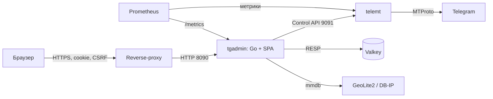

# Архитектура TeleMT Admin

Документ описывает компоненты, границы доверия, поток данных и точки
расширения. Он нужен разработчику, который впервые открывает репозиторий,
и оператору, который оценивает риски развёртывания.

## Компоненты

- **tgadmin** — один Go-бинарник. Отдаёт JSON API, встроенную SPA и
  `/metrics`; раз в `TGADMIN_COLLECT_INTERVAL` опрашивает Control API
  telemt. Фоновый планировщик раз в 30 секунд проверяет расписания
  автосброса квот.
- **telemt** — MTProto-прокси с FakeTLS. Единственный компонент, который
  знает секреты клиентов и ходит в Telegram.
- **Valkey** — пользователи UI, сессии, CSRF, TOTP, аудит, история
  адресов, страны, трафик, доверенные адреса и настройки.
- **GeoIP** — офлайн-базы mmdb, только чтение.
- **Prometheus и Grafana** — внешнее наблюдение; доступ к `/metrics`
  ограничен сетями.

## Аутентификация

Запросы с cookie приводятся к пользователю UI, запросы с
`Authorization: Bearer` — к сервисному аккаунту. Оба варианта дают единый
principal с именем, типом, ролью и scope. Cookie-сессия дополнительно
несёт CSRF; Bearer-токен CSRF не требует. Права `read`, `write`, `admin`
проверяются по scope и явному списку разрешённых путей. Управление
сервисами и токенами доступно только из cookie-сессии администратора.
Секреты токенов хранятся в Valkey как SHA-256.

## Границы доверия

1. **Браузер ↔ reverse-proxy** — HTTPS, HSTS, cookie `Secure`/`HttpOnly`,
   CSRF-токен для изменяющих запросов.
2. **Reverse-proxy ↔ tgadmin** — сеть `TGADMIN_ALLOWED_CIDRS`; адрес
   источника берётся из `X-Forwarded-For` только от
   `TGADMIN_TRUSTED_PROXIES`.
3. **tgadmin ↔ telemt** — внутренняя сеть или localhost, необязательный
   токен Control API.
4. **telemt ↔ Telegram** — MTProto через WireGuard/BGP на домашнем
   роутере; наружу открыт только порт прокси.
5. **Оператор ↔ базы GeoIP** — файлы читаются локально, сеть не нужна.

## Поток данных

1. Пользователь входит: пароль проверяется Argon2id, при включённой 2FA
   создаётся короткоживущая ожидающая сессия, затем TOTP-код обменивается
   на обычную сессию в Valkey.
2. Каждый сбор: `tgadmin` получает список клиентов из Control API,
   обогащает активные адреса страной/ASN, пишет историю и агрегаты в
   Valkey, обновляет метрики.
3. UI читает агрегаты из Valkey и Control API; полные адреса и ссылки
   видит только роль `admin`.
4. Аудит пишется в Valkey-поток `audit:events`; экспорт — CSV.

## Хранилище

| Префикс | Назначение | Срок |
|---|---|---|
| `auth:user:*` | пользователи UI, пароли, 2FA | бессрочно |
| `auth:session:*` | сессии | TTL сессии |
| `auth:totp:*` | ожидающие 2FA | 5 минут |
| `audit:events` | аудит | 10 000 последних |
| `iphist:*` | история IP, страны, трафик | 30 дней |
| `trusted:*` | доверенные страны и адреса | бессрочно |
| `risk:user:*` | пороги риска клиента | бессрочно |
| `settings:*` | глобальные настройки и версия | бессрочно |
| `limit:*` | шаблоны лимитов и шаблон по умолчанию | бессрочно |

Схема совместима внутри линии 1.x; изменения описываются в
[UPGRADE.md](UPGRADE.md).

## Безопасность

- Пароли — Argon2id с солью; TOTP-секреты шифруются AES-GCM ключом
  `TGADMIN_TOTP_KEY`.
- Все входные JSON-тела ограничены 1 МиБ и валидируются.
- Имена клиентов и IP проверяются регулярными выражениями и
  `netip.ParseAddr`.
- SQL нет; Valkey-команды параметризованы.
- CSP, `X-Content-Type-Options`, `X-Frame-Options`, `Referrer-Policy`,
  HSTS.
- Секреты не попадают в логи; сообщения telemt редактируются.
- Релизы подписаны cosign, к релизу приложены SBOM и provenance.

Подробнее — [SECURITY.md](../SECURITY.md) и
[ASSURANCE.md](ASSURANCE.md).

## Расширение

- Новый эндпоинт: `internal/web`, регистрация в `server.go`, тест в
  `api_*_test.go`, описание в [API.md](API.md).
- Новое поле клиента: `internal/telemt`, `apiUser`, UI-тип в
  `frontend/src/api.ts`.
- Новая метрика: `internal/collector`, затем панель в `mkt_monitoring`.
- Новый источник GeoIP: `internal/geoip`, интерфейс `Resolver`.
